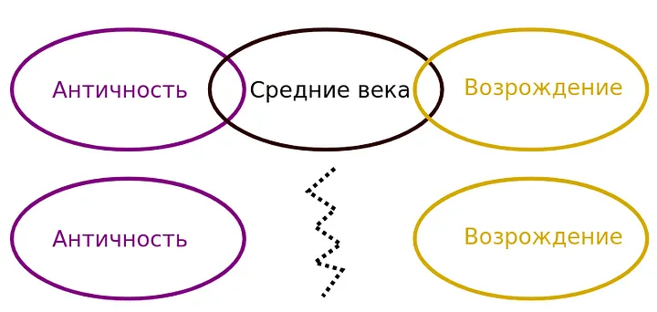
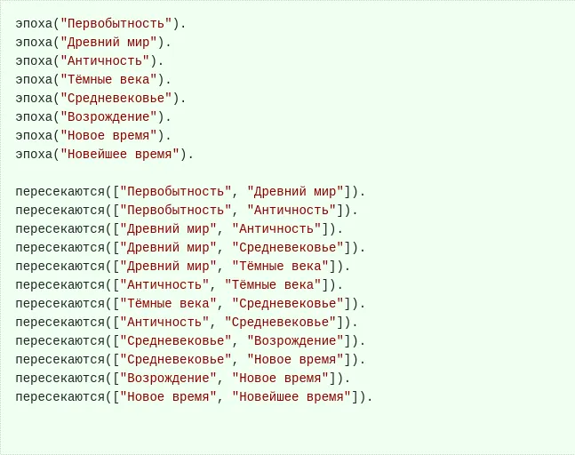

<script lang="ts">
   	import Pinup from  '#lib/components/Pinup.svelte';
    import banner from './banner.webp'
    import pinup  from './pinup.webp'
</script>

<Pinup {title} {description} {pinup} {banner} />

## Не только для «технарей»

В заголовке этой статьи слово Prolog написано мало того что латиницей, так еще и с заглавной буквы. Это объясняется тем, что в нем упомянут язык программирования `Prolog`, используемый для создания экспертных систем. Мне давно хотелось применить его к какой-нибудь гуманитарной задаче, но всё как-то не доходили руки. Во-первых потому, что сама эта затея выглядит как некая «блажь», и всегда находятся «дела поважнее».

Во-вторых, `Prolog` — язык необычный, требует усилий при освоении. Написанные на нем программы представляют собой не ряд последовательно выполняемых инструкций, как в других языках программирования, а некие логические уравнения. Если их правильно составить — программа сама находит ответ на тот или иной запрос. Для историков, социологов, лингвистов этот язык программирования мог бы стать незаменимым инструментом, но, к сожалению, даже среди программистов не так много людей, которые им владеют. Многие и вовсе считают его не более чем забавным раритетом.

В-третьих, большинство реализаций Prolog работают лишь с англоязычным синтаксисом, а хотелось бы писать программы, в которых при желании может разобраться русскоязычный читатель.

Понемногу все эти трудности были преодолены. Я нашел реализацию `Prolog`, поддерживающую инструкции на любых естественных языках, в том числе на русском. Это `SWI-Prolog`, продукт зрелый, так сказать «академический», обладающий необъятным количеством возможностей. Попрактиковаться в написании программ на `Prolog` мне тоже довелось в последнее время немало, поскольку я консультирую студентов `IT`-специальностей, а язык этот, оказывается, в некоторых вузах входит в учебные программы. Наконец, стремление применить `Prolog` к гуманитарным исследованиям с годами лишь усилилось, значит это не блажь, а некое обоснованное стремление. Исторического материала, который можно было бы обработать с помощью `Prolog`, накопилось у меня много.

Прежде чем приступить к решению конкретных задач, предлагаю попрактиковаться на чем-нибудь простом, чтобы понять суть методики. Возьмем для примера одну из основополагающих концепций официальной хронологии — деление процесса развития человечества на исторические эпохи.

Историки разделили предмет своего изучения — «ленту времени» — на характерные участки, которые знакомы даже школьникам: первобытно-общинный строй (примерно 10 тыс. лет назад и ранее), Древний мир (примерно до V в. н. э.), Средние века (примерно до XV в. н. э.), Новое время (примерно до конца XIX в.), Новейшее время (нынешнее, в рамках 3–4 последних поколений).

Деление это очень условное, спорное, с нечеткими границами, но, по крайней мере, при упоминании этих терминов все более-менее понимают, о чем идет речь. В рамках этих больших эпох выделяют «подэпохи». Так, «внутри» Древнего мира помещают Античность (VI в. до н. э. — V в. н. э.), основные события которой разворачиваются вокруг древних Греции и Рима. В Средневековье выделяют Темные века (от падения Рима до Карла Великого). Новое время включает в себя эпоху Возрождения (XIV-XVI вв.) и т. д.

Иногда для решения той или иной исторической задачи достаточно четко определить принадлежность сравниваемых событий, персон или явлений к той или эпохе, и тогда сразу становится понятным, могло такое произойти или нет. Но дело в том, что границы между эпохами размыты, особенно в контексте разных стран (где-то, например, «Средневековье» наступило раньше, где-то позже). Но даже если «очистить» эпохи друг от друга очень грубо, кое-что уже может проясниться. Например, никто не будет спорить с тем, что Античность и Новейшее время не пересекаются, иначе Юлий Цезарь мог бы оказаться современником Николая II. Попробуем выполнить такое разделение применительно, например, к эпохам Античности, Средневековья и Возрождения (это как бы «подэпоха» Нового времени, но сути не меняет).



Допустим, некое событие относят учеными то к античности, то к Средневековью (например, что-то связанное со временами Великого переселения народов, растянувшимися на несколько столетий). Такое соотнесение будет считаться достаточно достоверным. Хотя четкой границы между соседними эпохами нет, можно найти дополнительные аргументы для классификации. Но если событие или явление идентифицируются то как происходившие в Античности, то как происходившие в эпоху Возрождения (т. е. датируется не смежными эпохами), то тут стоит поискать фальсификацию. Об этом много говорят и пишут т. н. альтернативные историки, но для внесения ясности нужна общепринятая форма записи фактов, глядя на которую все понимали бы логику аргументации. Язык `Prolog`, мне кажется, подходит для этого как нельзя лучше. Нужно только научить историков и других гуманитариев им пользоваться, и эта статья (а я планирую написать на эту тему еще несколько) может стать для кого-то первым шагом к достижению такой ясности.

Замечу, что публикуемые здесь примеры кода — не просто учебный материал, а реальные программы, отлаженные и работающие в среде `SWI-Prolog`.

## Коллекция фактов — основа языка Prolog

Язык Prolog, говоря упрощенно, состоит из термов (утверждений, фактов) и правил (выражений, функций, процедур, операций над фактами, если сравнивать правила Prolog с обычными языками программирования). Например, сведения об эпохах и их пересечениях можно описать так:



Можно обойтись даже и без квадратных скобок, но в процессе отладки
выяснилось, что так надежнее.

Теперь попробуем найти все эпохи, которые не пересекаются. Для этого
создадим правило:

[Правило «Эпохи не пересекаются»](./prolog_03.webp)

Результат будет такой (часть строк пропущена для наглядности):

```
Не пересекаются эпохи "Новейшее время" и "Новое время".
Не пересекаются эпохи "Новейшее время" и "Возрождение". 
Не пересекаются эпохи "Новейшее время" и "Средневековье". 
... 
Не пересекаются эпохи "Новое время" и "Возрождение". % Ложь! 
... 
Не пересекаются эпохи "Древний мир" и "Первобытность". % Ложь! 
...
```

Результат получился явно неудовлетворительный. В списке фактов сказано,
что «Первобытность» и «Древний мир» пересекаются, программа же выдает
обратный результат. В чем дело? Дело в том, что `Prolog` находит решения
методом перебора, т.е. рассматривает не только пары вида

```
пересекаются(["Первобытность", "Древний мир"]).
```

но и

```
пересекаются(["Древний мир", "Первобытность"]).
```

Поскольку пара “Древний мир” и “Первобытность” не упомянута как
пересекающаяся, она и попала в вывод, что не противоречит логике
программы, но противоречит искомому решению. Попробуем скорректировать
программу очевидным способом:

[Правило «Эпохи не пересекаются»](./prolog_04.webp)

Теперь результат соответствует нашим интуитивным ожиданиям:

```
Не пересекаются эпохи "Новейшее время" и "Возрождение". 
Не пересекаются эпохи "Новейшее время" и "Средневековье". 
Не пересекаются эпохи "Новейшее время" и "Тёмные века". 
Не пересекаются эпохи "Новейшее время" и "Античность". 
Не пересекаются эпохи "Новейшее время" и "Древний мир". 
Не пересекаются эпохи "Новейшее время" и "Первобытность". 
Не пересекаются эпохи "Новое время" и "Тёмные века". 
Не пересекаются эпохи "Новое время" и "Античность". 
Не пересекаются эпохи "Новое время" и "Древний мир". 
Не пересекаются эпохи "Новое время" и "Первобытность". 
Не пересекаются эпохи "Возрождение" и "Новейшее время". 
Не пересекаются эпохи "Возрождение" и "Тёмные века". 
Не пересекаются эпохи "Возрождение" и "Античность". 
Не пересекаются эпохи "Возрождение" и "Древний мир". 
Не пересекаются эпохи "Возрождение" и "Первобытность". 
Не пересекаются эпохи "Средневековье" и "Новейшее время". 
Не пересекаются эпохи "Средневековье" и "Первобытность". 
Не пересекаются эпохи "Тёмные века" и "Новейшее время". 
Не пересекаются эпохи "Тёмные века" и "Новое время". 
Не пересекаются эпохи "Тёмные века" и "Возрождение". 
Не пересекаются эпохи "Тёмные века" и "Первобытность". 
Не пересекаются эпохи "Античность" и "Новейшее время". 
Не пересекаются эпохи "Античность" и "Новое время". 
Не пересекаются эпохи "Античность" и "Возрождение". 
Не пересекаются эпохи "Древний мир" и "Новейшее время". 
Не пересекаются эпохи "Древний мир" и "Новое время". 
Не пересекаются эпохи "Древний мир" и "Возрождение". 
Не пересекаются эпохи "Первобытность" и "Новейшее время". 
Не пересекаются эпохи "Первобытность" и "Новое время". 
Не пересекаются эпохи "Первобытность" и "Возрождение". 
Не пересекаются эпохи "Первобытность" и "Средневековье". 
Не пересекаются эпохи "Первобытность" и "Тёмные века".
```

Стоило ли ради этого нехитрого списка, который несложно составить и
вручную, «городить огород»? Конечно да, потому что, во-первых,
программирование на `Prolog` хорошо укрепляет навыки владения формальной
логикой, которыми должны в полной мере обладать не только «технари», но
и гуманитарии. Не зря этот предмет входит в учебные программы истфаков,
юрфаков и т.п. Во-вторых, программа масштабируема, т.е. при добавлении
в список новых фактов она будет по-прежнему надежно выполнять свою
работу, тогда как при ручной обработке длинного списка человек
обязательно что-нибудь пропустит или перепутает, да и ошибка выяснится
лишь спустя длительное время спустя, а не мгновенно, как при
использовании компьютера. Наконец, созданное здесь правило для поиска
непересекающихся эпох может еще не раз пригодится при решении более
интересных задач.

***

1. [Статья в Википедии](https://ru.wikipedia.org/wiki/Пролог_(язык_программирования))
1. [Публикация в Telegraph](https://telegra.ph/Istoricheskij-Prolog-10-17)
