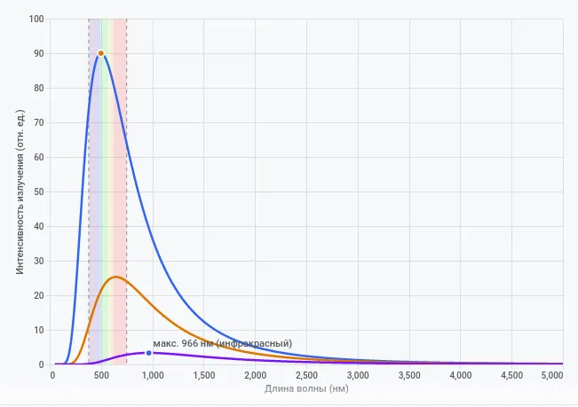
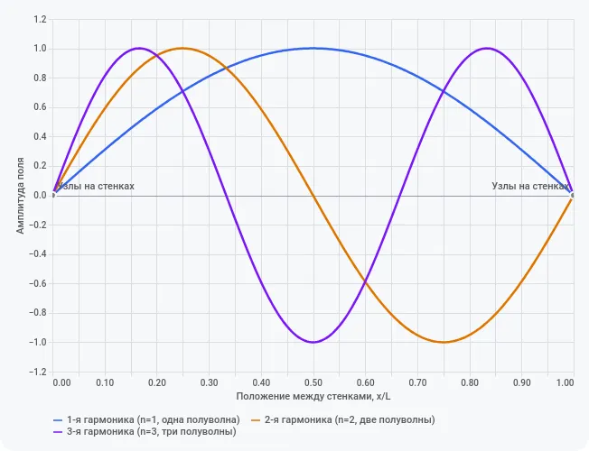
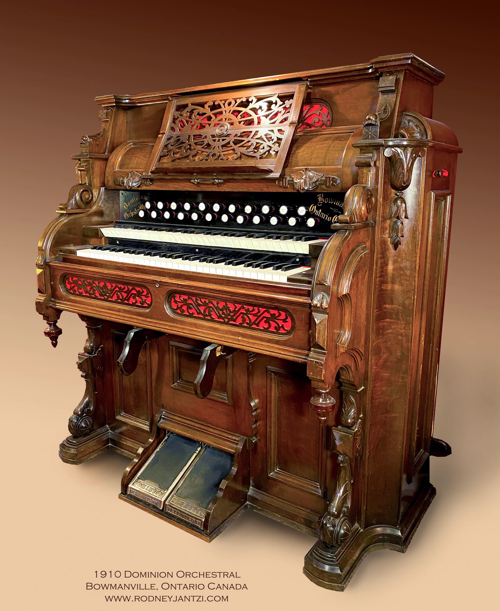

<!-- Pinup {title} {description} {pinup} {banner} / -->
<Pinup {title} {description} />

Написав несколько месяцев назад лонгрид [«Комфортабельное квантовое путешествие»](comfortable-quantum-airlines/), в котором закрепил своё понимание развития современной физики, я на время успокоился. За именами, казавшимися до того момента мистическими — Макс Планк, Альберт Эйнштейн, Нильс Бор, Эрвин Шрёдингер, Вернер Гейзенберг, Поль Дирак, Ричард Фейнман и другие — проявились хотя и незаурядные, но вполне понятные человеческие истории. Учёными двигало не желание «запудрить мозги» обывателям, а вполне насущные профессиональные потребности. Однако в тот раз я так выложился, стараясь усвоить материал и изложить его в наглядном виде (в первую очередь для себя, чтобы «закрыть гештальт»), что на осмысление самой квантовой теории сил уже не осталось.

С тех пор я не упускал возможностей узнать что-нибудь новое на эту тему, хотя и не слишком настойчиво. Начиная смотреть очередное видео о квантовой механике, я думал на манер героя одного анекдота: «Не догоню — так хоть согреюсь». И вот вчера количество перешло в качество. Мне попался ролик [«Что такое катастрофа ультрафиолетового излучения?»](https://youtu.be/S7A7JO4Bz7M), после просмотра которого всё встало на свои места. Я почувствовал себя так, как будто перепрыгнул планку, установленную Максом Планком более 120 лет назад. По крайней мере, этот рубеж перестал быть пугающим.

Как и в предыдущем случае, всё оказалось довольно буднично и вполне доступно любому более-менее начитанному человеку — даже без ярко выраженного физико-математического склада ума. Не обязательно с ходу разбираться во всех тонкостях формулы Планка (хотя и в ней нет ничего принципиально запредельного), чтобы ясно представить себе тогдашнюю обстановку.

<Footnote>
Прежде чем я перейду к сути, хочу заметить, что виноватыми в том, что квантовая физика до сих пор вызывает у соотечественников такие затруднения и даже отторжение, стали, мне думается, большевики. Если бы не их чванство и идеологическая зашоренность, из-за которых советской науке в 1930–1940-е годы пришлось догонять уходящий поезд научно-технического прогресса, не понадобились бы ни холодная война, ни шпионские скандалы, ни репрессии против неугодных учёных. Метод «цап-царап», когда вместо участия в полнокровной научной жизни хотят, не затрачивая усилий, лишь заполучить «вкусненькое», оказался губительным. Говорят, после Второй мировой войны на самом верху всерьёз интересовались у академиков, нельзя ли при создании атомной бомбы обойтись без «идеалистической» квантовой механики. Им ответили, что нет, и только тогда, спустя десятилетия после открытия Макса Планка, теоретикам нехотя дали некоторые идеологические послабления. Последствия этой близорукости известны.
</Footnote>

Вернёмся к видео, которое помогло мне понять суть квантовой механики — по крайней мере в том её виде, в котором она возникла на рубеже XIX и XX веков. В начале ролика описывается, как обычно, сложившаяся к 1900 году ситуация: физика пребывала в состоянии триумфа. Всем казалось, что её окончательное торжество наступит очень скоро, когда будут объединены три успешнейших теории, сложившихся к тому времени:

* механика Исаака Ньютона;
* термодинамика Людвига Больцмана;
* учение об электромагнетизме Джеймса Максвелла.

Здесь всё понятно, не будем в очередной раз на этом останавливаться.

А вот дальше в видео идёт рассказ о том, на что раньше я не обращал внимания: квантовая механика рождена не в тиши кабинетов, а в результате промышленной гонки, направленной в конечном итоге на подготовку к Первой мировой войне. Мощные европейские державы — Англия, Германия, Франция — находились в то время в процессе жёсткой промышленной конкуренции. Прежде чем Макс Планк сел 7 октября 1900 года за письменный стол и написал на почтовой открытке свою знаменитую формулу, положившую начало квантовой эре, правительства и корпорации затратили огромные средства на сбор экспериментальных данных.

## Борьба за имперскую лампочку

В Германии, в берлинском пригороде Шарлоттенбург, был построен целый научно-технический городок — Имперское физико-техническое ведомство, где физики днями и ночами не отходили от дорогостоящих установок, порождающих огромное количество табличных данных. Правительство и промышленники вроде Вернера фон Сименса не жалели на это денег: стране срочно требовались точные стандарты яркости для новых электрических ламп и надёжные способы измерять температуру в раскалённых сталеплавильных печах. Экспериментаторы буквально прощупывали тепловое излучение по миллиметрам, фиксируя поведение каждой длины волны с ювелирной точностью.

В это же время в Англии лорд Рэлей с помощниками вёл, может, и не такую масштабную по материальным затратам, но зато основанную на мощном теоретическом фундаменте деятельность. Британцы не стали полагаться на подбор эмпирических таблиц, а попытались вывести универсальный закон излучения «на кончике пера» — опираясь исключительно на безупречную, как им казалось, логику уравнений Максвелла и статистической физики Больцмана. Оба пути — немецкий экспериментальный и английский теоретический — вскоре сошлись в одной точке, но прежде чем говорить об этом, нужно разобраться с главным героем всей этой истории: так называемым абсолютно чёрным телом.

Что такое «абсолютно чёрное тело», мне долгое время мешало понять следующее. В учебниках или научно-популярной литературе начинают объяснять его свойства так: «Представьте себе нечто, от чего вообще не отражается свет. Оно чернее, чем даже чемпион в этом деле — сажа (от неё пара процентов фотонов всё-таки отскакивает)». Читатель… нет, пусть это лучше будет слушатель, ведь мы живём в эпоху, когда мультимедиа почти вытеснили бумажные книги. Так вот, слушатель в этот момент очень доволен: «С большим удовольствием, — отвечает он автору учебника. — Нет ничего проще. Это примерно так же, как закрыть глаза», и даже на время действительно закрывает глаза, демонстрируя, какой он прилежный ученик. «В конце XIX века, — непринуждённо продолжает автор, — физики пришли к выводу, что электромагнитное поле, исходящее от нагреваемого абсолютно чёрного тела…» В этот момент глаза у слушателя не просто открываются, а становятся «по пять копеек»: «Что?! Абсолютно чёрное тело излучает? Чем же тогда оно отличается от абсолютно белого, которое отправляет наружу столько же энергии, сколько получило?»

Обычно в такие моменты хочется отложить книжку (или поставить на паузу видео) и хорошенько подумать, как такое может быть: абсолютно чёрное — и вдруг светится. А жизнь так устроена, что если ты отложил учебник на минуточку, чтобы собраться с мыслями и попить чайку, то к чтению можешь уже и не вернуться. Обязательно найдутся какие-нибудь более важные или интересные дела, «благодаря» которым он так и останется с закладкой на не слишком далёкой странице, как у помещика Манилова. Но на этот раз всё было не так. В вышеупомянутом видео очень удачно было описано, как устроено абсолютно чёрное тело, и, проскочив через этот момент, я благополучно добрался до конца.

Оказывается, энергия внутрь абсолютно чёрного тела поступает не от того, что на его внешнюю поверхность чем-то светят. Его следует представлять себе как полую сферу с толстыми стенками, размером, скажем, с футбольный мяч. В стенке просверлена тонкая дырочка, через которую внутрь залетают фотоны. Судьба их печальна. Подобно рыбам, угодившим в вершу — ловушку с широким входом, но узким выходом, — они остаются внутри навсегда. Такому фотону ничего не остаётся, кроме как, потыкавшись о внутреннюю шершавую поверхность абсолютно чёрного тела, отдать ловушке всю свою энергию и сгинуть. Найти путь обратно в дырочку он уже не сможет за редчайшим исключением.

Однако всё не так плохо. Поскольку в природе ничто не исчезает бесследно, энергия «погибшего» внутри фотона рано или поздно будет абсолютно чёрным телом излучена. То есть оно абсолютно чёрное только для входящих фотонов, а так-то тело как тело, не чёрная дыра какая-нибудь. Другое дело, что излучённая энергия не имеет ничего общего с входящей. Её характеристики (частота и фаза излучаемых волн) зависят не от того, какие фотоны были поглощены, а от того, до какой температуры это тело нагрето. Как говорится, «фарш невозможно провернуть назад».

В этот момент хочется спросить: а зачем тогда вообще входящая дырочка, если нагрев производится не через неё? Оказывается, на выход дырочка работает не менее интересно, чем на вход. Благодаря малому размеру она не нарушает теплового равновесия внутри сферы и при этом исправно выпускает наружу электромагнитные волны во всех диапазонах, которые только успели там родиться. Вот тут-то физики их и ловят: пропуская исходящие из сферы лучи через призмы, они разлагают их на спектр и проводят, так сказать, «перепись населения». Во избежание путаницы я бы на месте авторов учебников «просверлил» в абсолютно чёрной сфере две дырочки и поставил у каждой по [демону Максвелла](https://ru.wikipedia.org/wiki/%D0%94%D0%B5%D0%BC%D0%BE%D0%BD_%D0%9C%D0%B0%D0%BA%D1%81%D0%B2%D0%B5%D0%BB%D0%BB%D0%B0): один пропускает только внутрь, другой — только наружу. Тогда оно действительно станет похожим на мясорубку (генератор энтропии).

В зависимости от температуры нагрева спектр из дырочки испускается самый разный: сначала нагретое тело становится просто тёплым (инфракрасное излучение), потом светится красным, потом жёлтым, потом белым, а потом… Но не будем забегать вперёд.

<a name="gorb">&nbsp;</a>

<Figure caption="Свечение «абсолютно чёрного тела»">
    <BlackBodyChart />
</Figure>

<!--  -->

Тут самое время вспомнить, с чего началось проведение таких экспериментов: предпринимателям хотелось знать, до какой температуры нужно нагревать тугоплавкую нить в лампах накаливания, чтобы они светили как можно ярче, как можно более приятным для глаз светом, но потребляли при этом как можно меньше энергии. Вот и вся «таинственная» подоплёка квантовой механики! Чистой воды «барыжничество». Мы же помним, что одним из организаторов Имперского физико-технического ведомства была компания Siemens, уже тогда сделавшая ставку на электротехнику.

## Раскалённая «фисгармонь»

Белый свет составной, это знает любой школьник. Такое излучение складывается из волн разной длины. Откуда же они берутся внутри нашей разогретой сферы? Физики объясняют, что среди бултыхающихся там электромагнитных волн «выживают» только те, кому повезло точно уложиться между стенками — точнее, между теми точками на внутренней поверхности, от которых они отразились. Остальные погибают в пучине хаоса, царящего внутри абсолютно чёрного тела. Волны, точно умещающиеся между стенками, называются стоячими. Их можно наблюдать в музыкальных инструментах, о чём сейчас и пойдёт речь.

<!--  -->

<Figure caption="Стоячие волны">
    <StandingWaves />
</Figure>

Выжившая внутри нагретой сферы и многократно отражённая волна рано или поздно вылетает через ту самую дырочку, радуя находящихся снаружи физиков своим цветом. Но позвольте, как же температура порождает электромагнитные волны? Не знаете? Вот и Макс Планк не знал! Ни о каком устройстве атома с его заряженными протонами и электронами тогда ещё и не слыхивали — до опытов Резерфорда оставалось целых 11 лет. Однако, как честный физик, Планк не мог поспорить с результатами экспериментов: электромагнитные волны явно вылетали из отверстия нагретой сферы, и он решил применить теоретический «костыль» (далеко не последний в этой истории), чтобы эта неопределённость не мешала в дальнейших рассуждениях.

Помогло Планку то, что он был ещё и неплохим музыкантом. В то время теория музыки и связанная с ней акустика помогала многим физикам делать научные открытия. Взять, например, Эрнста Маха, с которым так нахраписто воевали те же большевики. Он тоже начинал с изучения звуковых колебаний, и это привело к тому, что под конец жизни он стал основателем одного из самых влиятельных философских направлений. Музыка была важна в науке XIX в. хотя бы потому, что у физиков иной раз и не было другого способа понять свойства волн, кроме как воспроизвести ситуацию на музыкальных инструментах. Вот и Макс Планк между делом играл на приобретённой по случаю 104-ступенчатой фисгармонии. Это такой музыкальный инструмент, что-то среднее между аккордеоном и фортепиано: клавиатура горизонтальная, играть можно сидя, но звук издают не струны, по которым ударяют молоточки, а металлические язычки, через которые проходит нагнетаемый педалями воздух. Сейчас такие уже не делают, фисгармонии после Второй мировой войны вытеснили дешёвые фортепиано, хотя в Индии производство таких старинных инструментов практикуется, говорят, до сих пор.

В детстве мне доводилось видеть внутреннее устройство аккордеона — точнее говоря, его отечественной разновидности, баяна. Кто-то выбросил такой на свалку, и мы с друзьями с удовольствием распотрошили несчастный инструмент. Самым ценным оказались те самые звуковоспроизводящие штучки: алюминиевые рамочки размером с костяшку домино, к каждой из которых привинчена стальная пластинка с язычком, вибрирующим, когда через него пропускают воздух. Язычки были разной длины: чем короче, тем выше звук. Мы с удовольствием дули в такие устройства прямо изо рта, погружая двор в звуковой хаос.

Это не просто припомнившийся кстати автобиографический факт. Макс Планк тоже знал, как устроены подобные музыкальные инструменты, и, когда пришла пора задуматься над тем, каким же образом внутри разогретой сферы зарождаются электромагнитные волны — да ещё и «разнокалиберные», — он просто мысленно утыкал внутреннюю поверхность сферы подобными микроскопическими излучателями, назвав их резонаторами. Мол, они-то и порождают, колеблясь от разогрева, электромагнитные волны, каждый на своей частоте.

Однако мы забежали вперёд. Резонаторы Планк придумал уже в процессе работы над своей знаменитой формулой. Теперь самое время поговорить, зачем она вообще понадобилась, а для этого нужно знать кое-что об «ультрафиолетовой катастрофе».

## «Всем выйти из сумрака!»

Знаменитый призыв из «Дневного дозора» как нельзя лучше подходит к моменту, когда хочется окончательно навести порядок внутри нашей воображаемой печки и заодно развеять одно очень соблазнительное заблуждение, в которое чуть было не угодил я сам.

Представим себе судьбу фотона, влетевшего через узкую дырочку внутрь сферы. Если внутренняя поверхность идеально отполирована, как зеркало, кажется, что у луча появляется неплохой шанс после пары-тройки отскоков выскользнуть обратно наружу. Значит, чтобы тело оставалось «абсолютно чёрным», стенки изнутри должны быть максимально непредсказуемыми — этаким фрактальным «ёжиком Вейерштрасса», сплошь покрытым хаотичными горами и оврагами, чтобы при каждом ударе луч уходил под новым углом и гарантированно запутывался в лабиринте.

Если мысленно уменьшиться и отправиться на экскурсию по такому рельефу, глазам откроется удивительный пейзаж: торчащие из стенки микроскопические кубики, прикреплённые одной вершиной, пирамидки, цилиндры, бесформенные глыбы и даже крошечные выросты, напоминающие те самые язычки от аккордеона. У каждого такого микрообъекта должна быть своя собственная частота колебаний, причём все они куда крупнее атома. А рядом вмурованы жаропрочные кристаллы, молекулы и тяжёлые атомы примесей. Так и подмывает объявить: вот же они — те самые низкочастотные резонаторы, порождающие многоголосие длинных волн! А поскольку объектов мельче атома на стенке не найти, то и волны короче определённого предела испускать просто некому. Получается, «горбатый» график — это просто перепись размеров бугорков на стенке, а постоянная Планка — свидетельство того, что пространство нельзя дробить мельче атома?

Увы (или к счастью), Природа устроена хитрее, и эта стройная механическая картина разбивается сразу о три факта.

* **Спектр не зависит от «геологии» стенок.** Если бы низкие частоты рождались от вибрации крупных кристалликов и пылинок, то печи из разных материалов светили бы по-разному. Но ещё Густав Кирхгоф доказал, а Генрих Рубенс в Берлине блестяще подтвердил: абсолютно чёрные полости из гладкой платины, шершавой сажи и фарфора при одинаковой температуре выдают абсолютно идентичный «горбатый» график. Даже идеально зеркальная сфера с крошечным отверстием работает как ловушка: луч в ней скачет по хордам сотни раз, и крошечной доли процента поглощения при каждом ударе хватает, чтобы полностью «переварить» свет. Вся шершавость и химический состав сгорают в тепловом равновесии — итоговый спектр зависит только от температуры.
* **Атом — не жёсткий камертон одного размера.** В мире акустики большой язычок баяна действительно даёт низкий звук, а маленький — высокий. Но электромагнитные волны рождаются не от механической тряски «кубиков», а при перестройке электрических зарядов внутри атома, где длина волны зависит только от порции сброшенной энергии ($\Delta E = h\nu$). Крошечный атом водорода размером в десятую долю нанометра легко излучает космическую радиоволну длиной $21\text{ см}$ — в два миллиарда раз больше самого себя (для этого электрону внутри атома достаточно просто «перевернуться» спином в другую сторону). И тот же самый атом при сильном нагреве спокойно выдаёт рентгеновские лучи в тысячи раз короче собственного диаметра.
* **Постоянная Планка ограничивает энергию, а не размер деталей.** Константа $h$ измеряется в джоулях на секунду — она ставит шлагбаум не для габаритов резонатора, а для порции энергии. Даже если бы внутри печи вообще не было никаких шероховатостей, при заданной температуре у частиц просто не хватает теплового запаса, чтобы оплатить «билет» в жёсткий ультрафиолет.

Сам Макс Планк недаром назвал свои осцилляторы абстрактными «резонаторами»: ему было совершенно неважно, из каких бугорков или атомов они слеплены. Для него это были просто математические антенны всех возможных частот — от нуля до бесконечности, — на примере которых он высчитывал, как Природа делит тепловую энергию между ними.

## Знатно пригорело

Современное вульгарное выражение «знатно пригорело», означающее крайнюю степень конфуза, как нельзя лучше подходит для описания ситуации, сложившейся в теоретической физике к концу XIX века. Дело не только в том, что тогдашний теоретический тупик был действительно связан с нагреванием «абсолютно чёрного тела». Физики, считавшиеся до этого на протяжении десятилетий королями интеллектуального мира, вдруг оказались не в состоянии объяснить данные, приходившие из лабораторий — да не из каких-нибудь, а из лучших, таких как вышеупомянутое Имперское физико-техническое ведомство. Это был финансируемый государством и крупнейшими предпринимателями научно-исследовательский институт, оснащённый самым передовым оборудованием. Специалисты, которые там работали, тоже были лучшими из лучших, то есть сомневаться в данных, получаемых и тщательно документируемых в лабораториях Шарлоттенбурга, не было никаких оснований.

Макс Планк не был «свободным художником». Он находился в гуще тогдашних физических исследований и вместе со всеми ломал голову над странным парадоксом. Результаты экспериментов по нагреву вышеописанных сфер сводились в таблицы, на основании которых можно было построить график-«горб», показанный на <a href="#gorb">рисунке</a> выше. А вот придумать формулу, которая бы его описывала, никому не удавалось. Дело в том, что существовавшие на тот момент физические теории при математическом описании задокументированных в лабораториях процессов приводили к чудовищным бесконечностям, когда вычисления касались правой, высокочастотной части кривой. Нагретое тело должно было излучать на ультрафиолетовых частотах невообразимые количества энергии, не вписывающиеся ни в какие законы сохранения. Между тем на практике ничего подобного не происходило. Более того, никто никогда не видел в земных печах тела, раскалённого, скажем, до синего цвета. До белого — пожалуйста, даже выражение в русском языке есть: «довести до белого каления», а дальше — всё, природа не разрешает.

Физики тогда ощутили себя как сказочный чародей, которому отрубили его волшебную бороду. Только что он был всемогущим, и вдруг не может сотворить магию, которая раньше казалась забавой. При этом все окружающие невольно начинают задумываться: а был ли он вообще когда-нибудь грозным и великим? Вот это неловкое замешательство и получило в истории науки звучное название «ультрафиолетовая катастрофа».

Здесь нужно устранить одну иллюзию: мол, благородные учёные мужи вроде Ньютона и Лейбница мощными усилиями ума порождали свои триумфальные формулы. Как раз наоборот. Вся европейская наука зиждется на том, что сначала идут вызванные практическими потребностями измерения, грубые прикидки по принципу «тяп-ляп», безумные догадки, теоретические «костыли», даже мифы — и лишь через некоторое, порой довольно длительное, время на кого-то из учёных снисходит «озарение». Так что перед тем, например, как те же Ньютон и Лейбниц изобрели дифференциальное и интегральное счисление, их предшественникам пришлось промерять линейками, наверно, километры графиков, начерченных на клетчатой бумаге. Более того, если научное сообщество нащупывает какое-то решение опытным путём, методом подгонки под готовый ответ, то и это принимается на ура, пока кто-нибудь не придумает более адекватное объяснение. Так было и с «горбатым» графиком, иллюстрирующим зависимость интенсивности излучаемых из дырочки в раскалённой печи волн от частоты при той или иной фиксированной температуре.

Первым относительного успеха добился немецкий физик Вильгельм Вин в 1896 году. Опираясь на термодинамические аналогии с поведением молекул газа, он вывел формулу, которая по сути работала как удачная подгонка: она с ювелирной точностью ложилась на правую, высокочастотную часть «горба» (в области синего и ультрафиолетового света). Однако стоило экспериментаторам в Берлине продвинуться в сторону длинных инфракрасных волн, как закон Вина начинал давать такие погрешности, что оказывался практически бесполезным.

По удивительному стечению обстоятельств в то же самое время в Англии уже упоминавшийся выше лорд Рэлей (к которому позже присоединился Джеймс Джинс) подошёл к задаче с другого конца. Он строго применил законы классической механики и электродинамики к стоячим волнам внутри печи и получил безупречную формулу для левой, низкочастотной части графика. Увы, на высоких частотах эта формула вела себя как взбесившийся счётчик: вместо того чтобы загибаться вниз, кривая устремлялась в ту самую ультрафиолетовую бесконечность.

Вот эти два «достижения» и предстояло объединить Максу Планку.

## Связал бантиком

Научная жизнь на рубеже XIX и XX веков действительно была частью битвы за доминирование, которую вели между собой европейские империи. Учёные постоянно и всерьёз думали о том, как обеспечить преимущество для своей национальной «команды», не жалели сил, чтобы опередить соперников. Друг Макса Планка — физик Генрих Рубенс — работал в тех самых шарлоттенбургских лабораториях, где такие же, как он, экспериментаторы стремились как можно точнее измерить поведение электромагнитных волн, вырывающихся из узких отверстий раскалённых печей. Туда же, в Имперское физико-техническое ведомство, стекались все научно-технические новости, которые немцам удавалось собрать по всему тогдашнему цивилизованному миру.

Учёные, конечно же, не переставали при этом оставаться обычными людьми со своими увлечениями (вспомним фисгармонию), дружескими и родственными связями. Вот и к Максу Планку в его берлинскую квартиру 7 октября 1900 года, в воскресенье, пришли в гости Генрих Рубенс с супругой. Говорили, наверно, не только о делах, но за чаем Генрих рассказал о своих новейших измерениях инфракрасного излучения, которые показали, что уже почти ставший к тому времени классическим закон Вина не работает в области длинных волн.

Новость пробудила творческий порыв: после ухода гостей Планк сел за письменный стол и в течение нескольких часов вывел математическую формулу, объединившую известные на тот момент законы излучения. Это было непросто. За каждой из двух формул — отдельной для длинных волн, выведенной лордом Рэлеем, и отдельной для коротких, виновской — волочилось по никчёмному «хвосту», порождавшему ошибки. Вместо того чтобы плавно перетечь друг в друга, закономерности пересекались в каком-то странном месте совсем не гармоничным образом. Хоть завязочки пришей, да бантиком завяжи… Звучит смешно, но именно это и произошло: за ночь Планк умудрился так ловко подогнать «хвосты» друг к другу, что объединённая кривая стала выглядеть как вполне добротный график математической функции.

С точки зрения математики этот «бантик» выглядел на удивление изящно. Планк посмотрел, как ведут себя обе формулы с точки зрения термодинамики (через вторую производную энтропии по энергии): у Вина в знаменателе стояла энергия в первой степени, а у Рэлея — во второй. Недолго думая, Планк просто сложил их в одном знаменателе и проинтегрировал. В итоге родилось знаменитое уравнение:

$$
B(\nu, T) = \frac{2h\nu^3}{c^2} \cdot \frac{1}{e^{\frac{h\nu}{kT}} - 1}
$$

Главным фокусом здесь оказалась скромная «минус единица» в знаменателе под экспонентой. Когда частота $\nu$ мала (длинные волны), показатель экспоненты $\frac{h\nu}{kT}$ становится крошечным, и саму экспоненту можно разложить в ряд: $e^x \approx 1 + x$. Единица и «минус единица» в знаменателе тут же взаимно уничтожаются, внизу остаётся только $\frac{h\nu}{kT}$, а его частота $\nu$ благополучно сокращает куб $\nu^3$ в числителе до квадрата $\nu^2$. Формула Планка в этот момент автоматически превращается в закон Рэлея! Когда же частота $\nu$ огромна (короткие волны), экспонента $e^{\frac{h\nu}{kT}}$ взмывает до небес, единицей на её фоне можно смело пренебречь, и мощный знаменатель безжалостно «гасит» числитель, повторяя кривую Вина.

Единственное, что смущало физика, — он сам не до конца понимал, каким образом всё так гладко получилось. Поэтому вместо того, чтобы воскликнуть: «Эврика!» (а это действительно было в немалой степени эвристическое открытие), он решил поделиться результатом с одним-единственным человеком — тем самым Генрихом Рубенсом. Но здесь уж Планк не сдерживался. Он не стал излагать свои рассуждения в длинном письме, а в тот же вечер написал формулу на обычной почтовой карточке и отправил её другу-экспериментатору. Берлинская почта работала оперативно, так что Рубенс получил открытку уже утром следующего дня и сразу приступил к проверке формулы на накопленных в лаборатории данных.

Через несколько дней Планк получил от друга ответ: формула с поразительной точностью описывает все результаты измерений. Это вселило в теоретика надежду на дальнейший успех, и он взялся за дело более основательно. Уже 19 октября 1900 года Планк представил своё уравнение на заседании Немецкого физического общества. Правда, мало кто из присутствующих понял, что стал свидетелем рождения новой эры. Все были настолько ошеломлены, что почти никак не отреагировали.

## Открытка с видом на кванты

Должен предупредить читателя, что разухабистого стиля, в котором написаны предыдущие главы, в этой будет меньше, хотя я постараюсь сделать объяснение не слишком скучным. Хорошая новость заключается в том, что формула, во-первых, небольшая (раз уж поместилась на открытке), во-вторых — сам Планк не сопроводил её поначалу сложным теоретическим обоснованием, а значит, всё, что нам нужно, — просто держать её перед глазами и попытаться понять каждый из входящих в её состав компонентов. На «горбатый» график в ходе рассуждений тоже следует посматривать. Если говорить в терминах школьной алгебры, с помощью планковской формулы можно вычислить точки для его построения при любой выбранной температуре. Это умеют делать даже старшеклассники, так что не так уж всё страшно.

Сначала вспомним, какая задача стояла перед Планком: преодолеть «ультрафиолетовый кошмар». Графически он (кошмар) выглядел бы как улетающая вертикально «в космос» правая часть графика, что означает абсурдный выброс бесконечной энергии. Но наш график избавлен от этого безумства, на нём всё тихо-мирно. Он показывает, как распределяется излучение по частотам при заданной температуре: и на слишком низких, и на слишком высоких частотах тело почти ничего не излучает, «склоны горба» стремятся к нулю, хотя и по разным причинам. Основная же доля излучения приходится на среднюю часть кривой — а при температурах порядка солнечной пик и вовсе попадает ровно в тот диапазон, к которому в процессе эволюции привыкли наши глаза.

С левой частью всё просто: слишком длинным волнам (низким частотам) «негде разгуляться» внутри сравнительно небольшой сферы, так что здесь затухает почти всё, что сопоставимо с её внутренним диаметром. Волн, которые умудрились превратиться в стоячие, в этой части графика мало.

С правой частью сложнее. Внутри нагретой стенки частицы (те самые планковские резонаторы, место которых со временем займут современные атомы) беспрерывно толкаются, и энергия постоянно перераспределяется между соседями. Чтобы излучить волну на низкой частоте, резонатору нужно совсем чуть-чуть энергии. Но чем выше частота справа на графике, тем более крупную порцию энергии нужно накопить резонатору, чтобы вообще иметь право излучить свою волну. В среднем диапазоне, где находится основная часть «горба», кое-кому из резонаторов нередко удаётся накопить достаточно силёнок от соседских ударов и таки «вякнуть» — то есть отправить наружу порцию энергии, которую потом назовут фотоном. Вот тут Макс Планк и обнаружил идею кванта (от лат. quantum — «порция»): оказывается, энергия излучается из нагретой сферы не произвольными плавными потоками, а строго отмеренными дозами. То самое атомарное «вяканье» — единственный способ для энергии вырваться из пекла наружу. На сверхвысоких ультрафиолетовых частотах «купить право голоса», накопив нужную порцию энергии от случайных толчков, не удаётся почти никому — поэтому кривая в правой части не улетает в бесконечность, а покорно падает к нулю.

## Политическая жизнь резонаторов

Продолжая сравнивать резонаторы на внутренней поверхности разогретой сферы с парламентской республикой, можно сказать, что «высокочастотные участники» пребывают в перманентном стрессе. Они хотели бы «высказаться», «прославиться», но не могут договориться и только мешают друг другу. Так происходит с крабами, которые, будучи посаженными в ведро, мешают друг другу вылезти наружу. Не из вредности, а потому, что каждый видит в двинувшемся наверх соседе лишь удобную лестницу, хватает его за ногу и затягивает обратно. В итоге все вместе становятся чьим-то ужином. Редко какому из таких бедолаг повезёт «выбиться в люди».

Резонаторы низкочастотной части можно сравнить с немногочисленной знатью, которая, хотя и наделена постоянным правом голоса, занимается такими глупостями, что результаты их решений никогда не доводятся до ума. Их «прожекты» слишком масштабны и разбиваются о реальность, как не способные вырваться наружу волны, которым не суждено стать стоячими из-за неподходящей длины. Низкочастотные резонаторы можно сравнить с тем же помещиком Маниловым, который «думал… о том, как бы хорошо было жить с другом на берегу какой-нибудь реки, потом чрез эту реку начал строиться у него мост, потом огромнейший дом с таким высоким бельведером, что можно оттуда видеть даже Москву и там пить вечером чай на открытом воздухе и рассуждать о каких-нибудь приятных предметах». Он может себе это позволить, но бросит дело на полпути.

В средней части графика живут самые продуктивные — «резонаторы-демократы». Они не прочь как воспользоваться правом стать активистом (быть избранным в «парламент»), так и уступить его соседу, если видят, что тот «принесёт больше пользы». Это «политический центр», который и обеспечивает функционирование всей системы, то есть её заметность для внешнего наблюдателя.

Перейдём, с учётом этого образа, к формуле. Первый множитель в правой части уравнения Планка показывает «номинальную квоту» — сколько мест в «парламенте» по закону нарезано для каждой фракции ($\frac{2\nu^2}{c^2}$) с учётом «политического веса» её одного голоса ($h\nu$):

$$\frac{2h\nu^{3}}{c^{2}}$$

С физической точки зрения здесь учтён объём внутри нагретой сферы и длина каждой возможной волны. Проблема в том, что на бумаге этот закон выглядит слишком «демократичным» и даже усугубляет «ультрафиолетовый кошмар»: чем выше частота $\nu$, тем быстрее растёт куб в числителе. До Планка считалось, что природа обязана честно распределить мандаты между всеми желающими, а следовательно, любой тёплый предмет должен мгновенно выплеснуть всю энергию в виде смертельного ультрафиолета и рентгена. То есть объём «парламента» в таком сообществе был бы больше, чем количество всех его членов, включая бомжей, сумасшедших и грудных младенцев. Даже если прибавить находящихся в утробе и все существующие сперматозоиды с яйцеклетками, в таком «парламенте» всё ещё останутся свободные места.

Планк понял, что в реальной политике так не бывает: одного лишь права выдвигаться мало, нужно ещё пройти сквозь «квантовую коррупцию» и суровый избирательный ценз. За этот негласный фильтр отвечает второй множитель формулы:

$$\frac{1}{e^{\frac{h\nu}{kT}} - 1}$$

По сути, эта дробь работает как беспощадная избирательная комиссия, которая оценивает «проходимость» каждого кандидата. В показателе экспоненты $e^{\frac{h\nu}{kT}}$ сравниваются две величины: высота входного барьера для конкретной частоты ($h\nu$) и средний административный ресурс, которым располагают «граждане резонаторы» при данной температуре печи ($kT$).

* **Для «низкочастотной знати»** частота $\nu$ ничтожна, а значит, входной ценз $h\nu$ для них — сущие копейки. Знаменатель $e^{\frac{h\nu}{kT}} - 1$ превращается в крошечную величину, и вся дробь становится огромной. Низкочастотники проходят в парламент без всяких препятствий, да ещё и проводят с собой целую ораву родственников и прихлебателей — правда, из-за своей малочисленности и маниловщины погоды на графике они всё равно не делают.
* **Для «высокочастотных активистов»** всё оборачивается катастрофой. Чем выше частота $\nu$, тем выше задирается планка «квантовой коррупции». Система как бы говорит, скривив губы: «Фи… Плебс!», и делает всё возможное, чтобы в парламент таких попало как можно меньше. Экспонента в знаменателе раздувается в неприступную бюрократическую стену из проверок, подписей и запретов. На карьерном пути такого «высокочастотного бедняка» лежит столько препятствий, что вероятность его попадания в парламент стремится к нулю — почти все кресла ультрафиолетовой фракции так и остаются пустыми.
* **В самой серединке** располагаются те самые «резонаторы-демократы»: барьер $h\nu$ для них уже ощутим, но при удачном стечении обстоятельств и поддержке соседей вполне преодолим. Именно они и формируют основной, видимый глазу «горб» реального парламента.

Так Планк одной строкой помирил идеальные законы природы с суровой реальностью: на бумаге мест для высоких частот по-прежнему бесконечно много, но на практике «квантовая коррупция» отсекает почти всех выскочек на дальних подступах к трибуне.

## Пьеса «На дне». В главной роли Макс Планк

Написав вечером 7 октября 1900 года свою формулу на почтовой открытке, Макс Планк испытал не триумф, а тихий ужас. Будучи убеждённым консерватором и поклонником классической строгости, он прекрасно понимал: уравнение работает безупречно, но сама «минус единица» и загадочная константа $h$ выглядят как удачная подгонка, фокус без разоблачения. Начались самые бессонные недели в его жизни — период, который сам физик позже назовёт «актом отчаяния».

Чтобы честно вывести свою формулу из законов термодинамики, Планку пришлось воспользоваться статистическим методом Людвига Больцмана, к которому он раньше относился с большим скепсисом. Метод работал так: нужно было мысленно разбить непрерывный поток энергии на крошечные одинаковые «ячейки» (порции), пересчитать все возможные способы распределить их по резонаторам, а в самом конце расчётов устремить размер такой ячейки к нулю. В классической физике это был обязательный ритуал: уменьшая ячейку до бесконечной малости, математик возвращал природе её привычную, плавную непрерывность.

Планк проделал всю комбинаторику, получил в точности ту самую формулу с открытки и приготовился сделать последний шаг — свести размер энергетической «ячейки» к нулю. И тут произошло немыслимое. Стоило ему попытаться растворить эту микроскопическую порцию в непрерывном потоке, как вся изящная конструкция тут же рассыпалась в прах, возвращая физику прямиком в «ультрафиолетовую катастрофу» Рэлея — Джинса. Природа буквально схватила учёного за руку и заявила: «Дальше дробить нельзя. Это дно».

Размер минимальной ячейки оказался не нулём, а крошечной, но жёстко фиксированной величиной — знаменитой постоянной Планка:

$$h \approx 6{,}626 \cdot 10^{-34}\text{ Дж}\cdot\text{с}$$

Тридцать три нуля после запятой! Неудивительно, что в нашем повседневном мире с его чайниками, бильярдными шарами и автомобилями эта дискретность абсолютно незаметна — точно так же, как издалека экран монитора кажется гладкой картинкой, хотя вблизи состоит из отдельных пикселей.

<Footnote>
Я был, кстати, шокирован, когда узнал, почему Планк выбрал для своей постоянной букву $h$. Это не какой-нибудь сакральный символ с семантикой, уходящей в античность, а просто первая буква немецкого слова *Hilfsgröße*, что можно перевести как «вспомогательная величина», а можно и как «временная заглушка» или даже просто «костыль». Сам Планк рассматривал её как временное математическое решение и не скрывал, что это подгонка под ответ. Изначально он не только не претендовал на открытие фундаментального закона, но даже стыдился этого своего «жульничества».
</Footnote>

Но на этом головокружительные масштабы не закончились. Скомбинировав свою новую константу $h$ со скоростью света и гравитационной постоянной Ньютона, Планк нащупал фундаментальные единицы самой ткани мироздания — в том числе умопомрачительную **планковскую длину**:

$$\ell_P \approx 1{,}6 \cdot 10^{-35}\text{ м}$$

Вдумайтесь в этот масштаб: на рубеже XIX и XX веков физики ещё спорили о реальности и размерах обычных атомов, до открытия атомного ядра оставалось больше десяти лет, а консервативный берлинский профессор уже на кончике пера нащупал величину, которая в сто триллионов триллионов раз меньше атома! Даже сегодняшним ускорителям частиц до этого предела — как пешком до соседней галактики: на масштабах планковской длины привычные нам пространство и время, по-видимому, вообще теряют смысл и превращаются в «квантовую пену».

Макс Планк ещё долгие годы надеялся, что его «ячейки» энергии — лишь временный математический костыль, который удастся как-нибудь сгладить (а прожил он без малого 90 лет: родился в 1858, умер в 1947 г.). Но джинн уже вырвался из бутылки: через пять лет молодой клерк патентного бюро Альберт Эйнштейн покажет, что свет действительно летит отдельными порциями-фотонами, а следом Нильс Бор, Вернер Гейзенберг и Эрвин Шрёдингер достроят на этом фундаменте величественное здание квантовой механики, а вскоре после смерти Планка Ричард Фейнман «полирнёт» всё это безупречной теорией [КЭД](https://ru.wikipedia.org/wiki/%D0%9A%D0%B2%D0%B0%D0%BD%D1%82%D0%BE%D0%B2%D0%B0%D1%8F_%D1%8D%D0%BB%D0%B5%D0%BA%D1%82%D1%80%D0%BE%D0%B4%D0%B8%D0%BD%D0%B0%D0%BC%D0%B8%D0%BA%D0%B0).

Вот так, начавшись с сугубо приземлённой задачи — как сделать лампочку поярче и поэкономичнее для нужд германской промышленности, — история привела человечество к самому дну мироздания. И, пожалуй, лучшим памятником этому перевороту остаётся та самая почтовая открытка от 7 октября 1900 года (к сожалению, она не сохранилась). Скромный картонный прямоугольник, на котором Макс Планк сам того не желая установил для всей мировой науки новую высоту — ту самую планку, перепрыгнув которую однажды, уже невозможно смотреть на мир по-прежнему.

## Занавес. Свет. Музыка!

На этом можно было бы поставить точку, но не оставлять же бедного профессора в плачевном состоянии — наедине с бессонницей и ощущением, что он собственными руками разрушил здание классической физики. К тому же я ведь обещал читателям в самом начале, что разобраться с его формулой — не сложнее, чем составить школьную табличку с точками $x$ и $y$ для построения графика по учебнику алгебры, но сам этого так и не сделал! Всё это время я занимался примерно тем же, чем и Планк в октябре 1900 года: подбирал удачные образы, чтобы поскорее добраться до сути, ловко перескакивая через «неудобные» места.

В итоге у нас получился прекрасный «оркестр» с демократией резонаторов и квантовой коррупцией. Есть либретто — словесное описание уравнения: мол, вот здесь числитель набирает обороты, а вот тут экспонента всё гасит. Есть даже ноты — сама формула с открытки. Только вот музыка так и не прозвучала. Не пора ли, засучив рукава, посчитать хотя бы несколько точек, чтобы прощупать этот механизм на практике?

Сразу же возникает законное затруднение у нашего внутреннего «школьника»: а где здесь, собственно, $x$ и $y$? Мы ведь оставили левую часть уравнения без внимания. На самом деле всё элементарно:

$$y = B(\nu, T) = \frac{2h\nu^3}{c^2} \cdot \frac{1}{e^{\frac{h\nu}{kT}} - 1}$$

Здесь роль привычного $x$ играет частота $\nu$ (в герцах), а $y$ — это яркость излучения на данной частоте. Температуру $T$ мы задаём заранее, как условие задачи. Чтобы картина получилась наглядной, разогреем нашу воображаемую печку до $T = 5800\text{ К}$ — это температура поверхности Солнца, при которой вершина «горба» приходится ровно на видимый свет.

Можно было бы, конечно, забить формулу в какой-нибудь онлайн-калькулятор, но куда интереснее прикинуть, как бы с ней справился человек докомпьютерной эпохи. Я её ещё застал: в техникуме при расчётах нам даже калькуляторами пользоваться запрещали — разрешались только логарифмические линейки. На таком инструменте главная хитрость — не запутаться в нулях: значащие цифры двигают на шкалах бегунком, а порядки (степени десятки) держат в уме. При $T = 5800\text{ К}$ вся громоздкая физика сворачивается в два рабочих коэффициента: «тариф коррупции» в показателе экспоненты $z = \nu \cdot (8{,}275 \cdot 10^{-15})$ и множитель перед кубом в числителе $1{,}474 \cdot 10^{-50}$.

Давайте прогоним через линейку пять резонаторов из разных концов спектра — пусть каждый «вякнет» по разочку во славу квантовой механики!

<!--
| **Точка ($x = \nu$)** | **Диапазон** | **Показатель $z = \frac{h\nu}{kT}$** | **Числитель (квота) $\frac{2h\nu^3}{c^2}$** | **Знаменатель (фильтр) $e^z - 1$** | **Итог ($y = B$)** | **Как звучит резонатор** |
-->

| **Точка** | **Диапазон** | **Степень** | **Числ.** | **Знам.** | **Итог** | **Как звучит** |
|---|---|---|---|---|---|---|
| **$50\text{ Гц}$** | Ток в розетке | $4{,}14 \cdot 10^{-13}$ | $1{,}84 \cdot 10^{-45}$ | $4{,}14 \cdot 10^{-13}$ | **$4{,}45 \cdot 10^{-33}$** | **Глубочайший бас.** На линейке $e^z$ не сдвинется с единицы ни на волос — работает правило $e^z - 1 \approx z$. Коррупции нет, но и мест почти ноль: в зале тишина. |
| **$50\text{ ТГц}$** | ИК * | $0{,}414$ | $1{,}84 \cdot 10^{-9}$ | $0{,}512$ | **$3{,}60 \cdot 10^{-9}$** | **Тёплый гул.** Взятка $z$ ещё скромная ($0{,}41$), знаменатель меньше единицы и даже помогает числителю. Кривая уверенно ползёт вверх. |
| **$340\text{ ТГц}$** | Пик графика | $2{,}81$ | $5{,}80 \cdot 10^{-7}$ | $15{,}67$ | **$3{,}70 \cdot 10^{-8}$** | **Солист на вершине горба!** Куб в числителе уже разогнался, а экспонента в знаменателе ($e^{2{,}81} - 1 \approx 15{,}7$) ещё не успела задушить рост. Максимум яркости. |
| **$550\text{ ТГц}$** | Зелёный | $4{,}55$ | $2{,}45 \cdot 10^{-6}$ | $93{,}73$ | **$2{,}62 \cdot 10^{-8}$** | **Бодрый тенор.** Числитель вырос ещё в 4 раза, но экспонента в знаменателе прыгнула сразу в 6 раз ($e^{4{,}55} - 1 \approx 93{,}7$). Начинается плавный спуск. |
| **$2000\text{ ТГц}$** | УФ | $16{,}55$ | $1{,}18 \cdot 10^{-4}$ | $1{,}54 \cdot 10^7$ | **$7{,}67 \cdot 10^{-12}$** | **Сорванный фальцет.** Числитель вырос ещё в 48 раз, но знаменатель взлетел в **164 тысячи раз** ($e^{16{,}55} \approx 15{,}4\text{ млн}$)! Яркость рухнула в 3400 раз. |

<Footnote>
ИК — инфракрасный, УФ — ультрафиолет. Пик графика приходится на границу между инфракрасным и красным.
</Footnote>

<Figure caption="В терминах логарифмической линейки">
    <SlideRule slide={1} cursor={3.4} />
</Figure>

Даже беглого взгляда на эти пять строчек хватает, чтобы услышать, как устроена музыка квантового мира. Между третьей точкой ($340\text{ ТГц}$) и пятой ($2000\text{ ТГц}$) частота выросла всего в шесть раз. Куб в числителе послушно увеличился в $6^3 \approx 200$ раз. А вот экспонента в знаменателе за тот же скромный шаг скакнула с $15{,}7$ до пятнадцати с лишним миллионов — почти в миллион раз! Именно в этот момент на бегунке логарифмической линейки становится физически осязаемо, как «квантовая коррупция» переламывает хребет кубической параболе и сводит ультрафиолетовую катастрофу на нет.

Вот теперь оркестр действительно сыграл, а «дело Макса Планка» можно считать закрытым с чистой совестью и на вполне оптимистичной ноте: мир уцелел, свет горит ровно там, где видят наши глаза, а нам остаётся только аплодировать стоя.

***

Сам Макс Планк долгое время воспринимал собственное открытие как временный математический трюк, прожив с 1858 по 1947 год. Однако запущенный им процесс привел к созданию квантовой механики усилиями Эйнштейна, Бора, Гейзенберга, Шрёдингера и Фейнмана КЭД. Прикладная задача об эффективности лампочек для германской промышленности развернулась в фундаментальный переворот в физике, начавшийся с утраченной почтовой открытки Планка от 7 октября 1900 года.